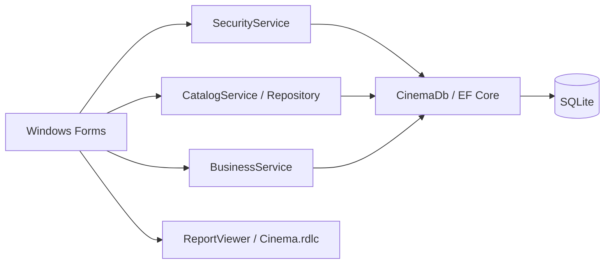
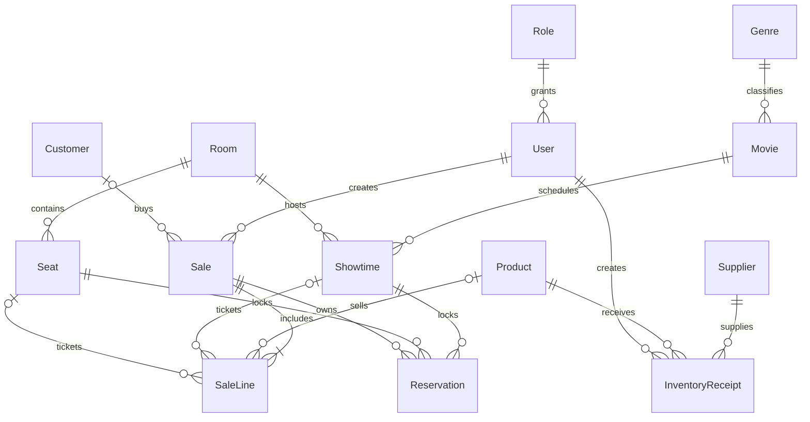

# Kiến trúc và mô hình dữ liệu

Reservation có unique index (ShowtimeId, SeatId). Khi hoàn, chỉ xóa Reservation; Sale và SaleLine được giữ để đối soát. Promotion được áp dụng thành DiscountPercent/Discount snapshot trên Sale; thay đổi khuyến mãi không làm đổi hóa đơn cũ. AuditEntry lưu UserId dạng giá trị để giữ nhật ký khi xóa một tài khoản chưa có giao dịch.
